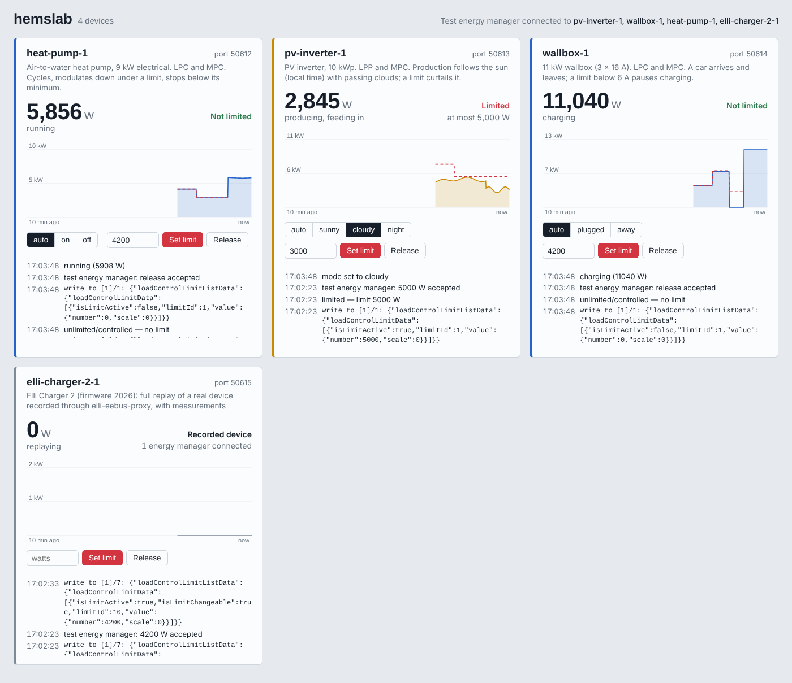

# hemslab

Simulierte Energiegeräte für alle, die Energiemanager (HEMS) bauen: Wärmepumpen, PV-Wechselrichter, Wallboxen und nachgespielte echte Geräte. Sie sprechen **EEBUS** im eigenen Netz wie die echten Geräte: Sie lassen sich koppeln, nehmen Leistungslimits an, fallen auf den Failsafe-Wert zurück und melden ihre Leistung.

Keine Hardware, kein Installateur, kein Warten auf Sonne.

[English](README.md) · Basiert auf [hupe1980/eebus](https://github.com/hupe1980/eebus)

> **Status: 0.1.0, früh.** Nur EEBUS. Modbus/SunSpec und OCPP folgen.

## Schnellstart

Das Programm für dein System aus dem [neuesten Release](https://github.com/frane/hemslab/releases/latest) laden und starten:

```bash
./hemslab run heat-pump pv-inverter wallbox elli-charger-2
```

Dann **http://localhost:8080** öffnen.

Jedes Gerät bekommt eine eigene SKI und einen eigenen Port (4712, 4713, …) und kündigt sich per mDNS an. Der Energiemanager findet sie wie echte Geräte. Standardmäßig koppeln sie sich mit jedem, der anfragt.



Die Weboberfläche zeigt pro Gerät:
- die Leistung
- das geltende Limit (rote gestrichelte Linie)
- den LPC/LPP-Zustand
- jeden Schreibbefehl, den das Gerät bekommen hat

In der Oberfläche kannst du:
- Limits setzen und aufheben. Das läuft über einen eingebauten Test-Energiemanager, du brauchst also kein HEMS zum Ausprobieren.
- die Situation des Geräts ändern: Auto an- und abstecken, Sonne, Wolken oder Nacht, Wärmepumpe an oder aus.

## Geräte

`hemslab profiles` listet alle Profile auf.

**Generische Geräte** setzen ihre Use Cases nach Spezifikation um (aus der Crate `eebus`) und verhalten sich wie echte Geräte:

| Profil | Use Cases | Verhalten |
|---|---|---|
| `heat-pump` | LPC, MPC | 6-kW-Verdichter: 20 Minuten an, 10 Minuten aus. Moduliert bei einem Limit herunter und stoppt unter 1,5 kW. |
| `pv-inverter` | LPP, MPC | 9,5 kW Spitze nach Sonnenstand (Ortszeit), mit Wolken. Ein Limit regelt die Erzeugung ab. |
| `wallbox` | LPC, MPC | 3 × 6–16 A. Ein Auto steht eine Stunde da und ist dann 15 Minuten weg. Lädt in ganzen Ampere und pausiert unter 6 A, wie echte Wallboxen. |

Alle drei starten im LPC/LPP-Zustand `init` mit ihrem Failsafe-Limit. Schweigt der Energiemanager, fallen sie auf Failsafe zurück. Sie melden Leistung gesamt und je Phase, Strom je Phase und Energie.

**Nachgespielte Geräte** sind echte Geräte, wie sie aufgezeichnet wurden: gleiche SPINE-Struktur, gleiche Use Cases, gleiche Antworten. Aufgezeichnete Messwerte laufen in einer Schleife.

| Profil | Quelle |
|---|---|
| `elli-charger-2` | Elli Charger 2, komplett mit 15 Minuten Messwerten (Mitschnitt mit [elli-eebus-proxy](https://github.com/frane/elli-eebus-proxy)) |
| `elli-charger-connect-pro`, `porsche-mobile-charger-connect`, `spelsberg-wallbox-smart-pro` | Wallboxen: Struktur und Use Cases |
| `kostal-smart-energy-meter`, `sma-home-manager-2` | Zähler und Energiemanager |
| `vaillant-arotherm`, `viessmann-vitoconnect` | Wärmepumpen |

Die Strukturen stammen aus [enbility/devices](https://github.com/enbility/devices) (MIT-Lizenz). `hemslab show <profil>` zeigt Entitäten, Features und Use Cases.

## Eigene Geräte

1. **Finden:** `hemslab discover` listet die EEBUS-Geräte im Netz mit ihrer SKI.
2. **Mitschneiden:** `hemslab record <SKI> --name lg-therma-v --minutes 15`. hemslab verbindet sich als Energiemanager, liest alles und abonniert jedes Feature. **hemslab-recorder** in den EEBUS-Einstellungen des Geräts koppeln. Akzeptiert das Gerät nur einen Energiemanager, den eigenen dafür kurz entfernen. Am Ende entstehen `lg-therma-v.jsonl` (Rohdaten) und `lg-therma-v.json` (Profil), Seriennummern sind geschwärzt. Mitschnitte von elli-eebus-proxy lassen sich mit `hemslab import` einlesen.
3. **Starten:** `hemslab run lg-therma-v.json`. Pull Requests mit neuen Profilen sind willkommen.

Generische Profile sind TOML-Dateien. Am einfachsten eine aus [`profiles/`](profiles/) kopieren und anpassen.

## Optionen

Siehe [README.md](README.md#options). Alle Optionen gibt es auch als Umgebungsvariable (`HEMSLAB_…`), die Geräteliste als `HEMSLAB_DEVICES`. Aus dem Quellcode: `cargo install --git https://github.com/frane/hemslab`. Für ein NAS gibt es ein Docker-Image (`docker-compose.yml`, Host-Networking für mDNS).

## Getestet gegen

- **Energy Guard und Monitoring Appliance der Crate `eebus`:** LPC-Limit, Aufhebung und MPC-Messwerte für generische und nachgespielte Geräte, dazu die Weboberfläche.
- **eebus-go als Energy Guard** (der Stack hinter evcc): Die Wallbox pausiert bei 3000 W, lädt bei 7000 W mit 10 A und nach der Aufhebung mit 16 A.
- **elli-eebus** (die Bibliothek hinter ha-elli): Sie liest die nachgespielte Elli wie die echte und setzt Limit und Failsafe.
- **Die ganze Kette ohne Hardware:** eebus-go → elli-eebus-proxy → nachgespielte Elli. Die Limits 3000 W, 0 W und die Aufhebung kommen an.

## Lizenz

MIT
